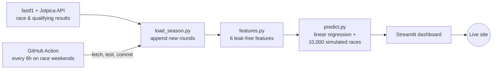
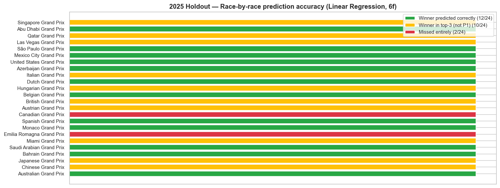
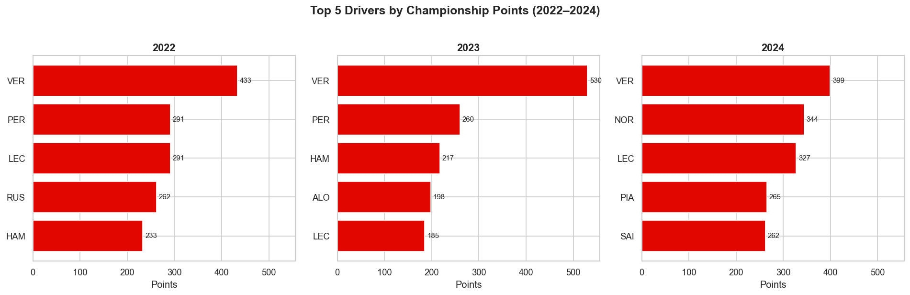
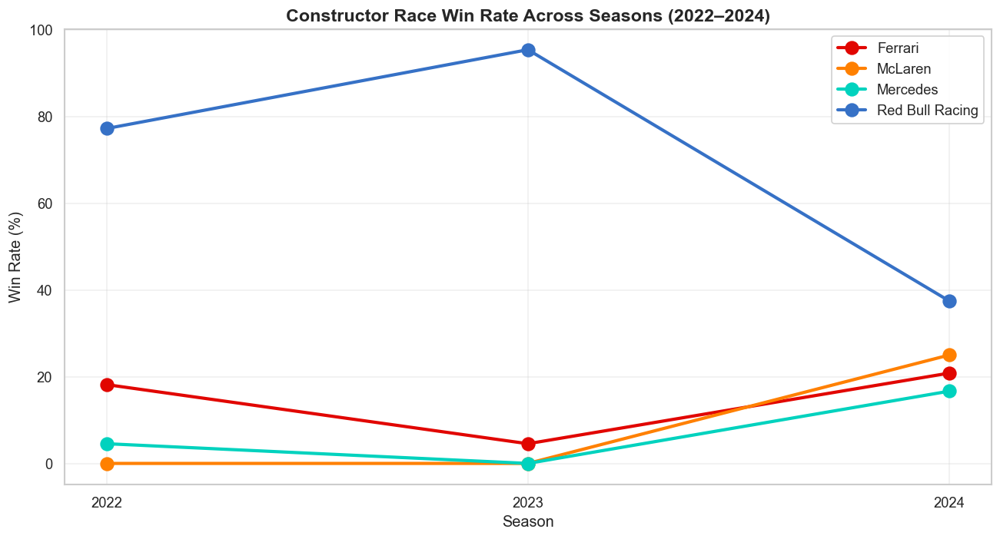
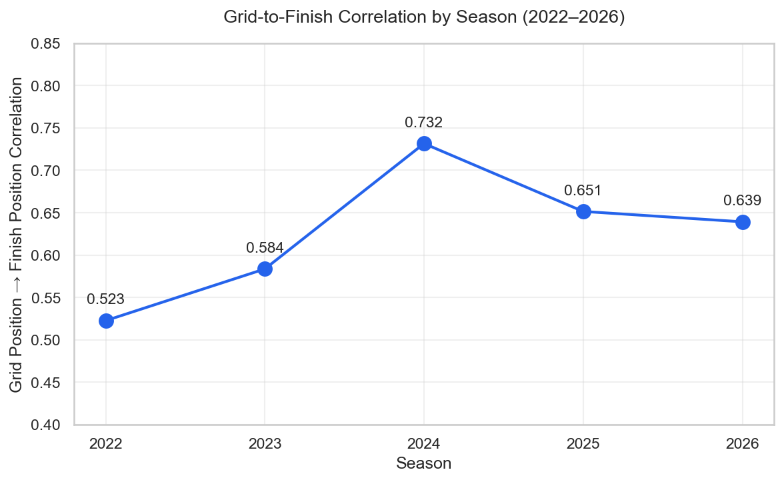
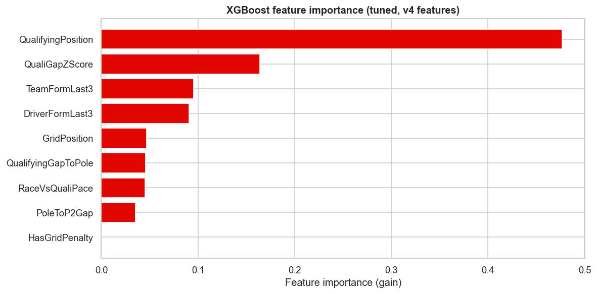

# F1 Race Winner Predictor

Predicts every driver's finishing position in Formula 1 races from qualifying, recent form and circuit type, and publishes a live prediction for each 2026 race as soon as qualifying ends.

**[▶ Live dashboard](https://f1-race-predictor-orp.streamlit.app/)** · example race page: [2026 Singapore GP](https://f1-race-predictor-orp.streamlit.app/?season=2026&round=17)

## At a glance

- **Validated on unseen seasons.** Trained on 2022–2024, tested on all of 2025, then on 2026 under brand-new regulations. Both times it beats the "finish in qualifying order" baseline on overall error.
- **Live, with no manual steps.** A scheduled GitHub Action fetches each race weekend's data, rebuilds the features, runs the test suite and redeploys. The prediction for Sunday's race is up on Saturday evening.
- **Honest numbers.** Unit tests caught a target leak in one of my own features; the headline figure dropped from 100% to 91.7% and the correction is documented below. Win probabilities are checked against real outcomes before being shown.
- **Explainable.** For each driver, the dashboard shows exactly how qualifying, driver form and team form add up to the prediction.
- **Engineered like a product:** append-only data loading with an API fallback, 36 pytest tests (features, data integrity, predictions and the app itself), shareable links per race.

## How it works



For each driver and race, the model predicts a finishing position; the lowest prediction is the predicted winner. Simulating each race 10,000 times with the model's own past errors turns those positions into win and podium chances.

## Results

| | Pole baseline | Model |
|---|---|---|
| **2025 holdout** (24 races, never seen during development) | | |
| RMSE (positions) | 4.69 | **4.25** |
| Winner in predicted top 3 | 95.8% | 91.7% (22/24) |
| Exact winner | 66.7% | 50.0% |
| **2026 so far** (rounds 1–16, new regulations) | | |
| RMSE (positions) | 5.14 | **4.77** |
| Winner in predicted top 3 | 93.8% | 87.5% (14/16) |
| Exact winner | 68.8% | 68.8% |

The model's edge is ranking the whole grid: it beats the pole baseline on RMSE by 0.44 positions in 2025 and 0.36 in 2026. Picking the pole-sitter is better at naming the exact winner, but it says nothing about the other 19–21 drivers.

*2026 figures as of round 16 (Bahrain, 4 Oct 2026). The season updates automatically; the [dashboard](https://f1-race-predictor-orp.streamlit.app/) sidebar always shows the current numbers.*

> **Correction (Sept 2026):** earlier versions of this README reported 100% top-3 accuracy. That figure was inflated by a leak in `TeamFormLast3`: team form was computed over the team's previous *rows*, and with two cars per race the second driver's feature included their teammate's result from the same race. Team form is now aggregated per race before the rolling window, a regression test guards it, and all numbers above are from the corrected pipeline.



## What I'd do next

- **Practice-pace features** (long-run pace from Friday practice) for an earlier, pre-qualifying prediction. Blocked for now: fastf1 3.7 can't parse 2026 car telemetry.
- **Use the official starting grid** once it's published. The model currently assumes grid = qualifying order, so it misses late grid penalties (Hadjar at Bahrain 2026).
- **Season review** after the final race (Abu Dhabi, 6 Dec 2026).

---

## Dashboard

Pick any race from 2023–2026, or the next 2026 race once qualifying is done:

- predicted vs actual podium, and the full grid with each driver's chance to win and reach the podium ([calibration check: notebook 08](notebooks/08_win_probability_calibration.ipynb))
- a race-story chart tracing every driver from qualifying to predicted finish to result
- a per-driver breakdown of why the model predicts each position (exact for a linear model)
- accuracy in F1 timing colours, circuit maps drawn from car position data, and a next-race countdown

Every race has a shareable link, e.g. [`?season=2026&round=17`](https://f1-race-predictor-orp.streamlit.app/?season=2026&round=17).

## Key findings from multi-season EDA (2022-2024)

### Verstappen dominated all three seasons; margins varied wildly



Verstappen won every championship in the dataset, but the margin to second place collapsed from 270 points (2023) to 55 points (2024), the largest year-on-year compression in modern F1.

### Constructor balance reset between 2023 and 2024



Red Bull's win rate fell from 95.5% in 2023 to 37.5% in 2024, a ~60 percentage point swing. McLaren went from zero wins to 25%, the steepest single-season rise in the dataset.

### Qualifying predictiveness rose, then broke trend in 2025



| Season | Grid → Finish Correlation | N |
|--------|---------------------------|---|
| 2022   | 0.523 | 439 |
| 2023   | 0.584 | 439 |
| 2024   | 0.732 | 479 |
| 2025   | 0.651 | 479 |
| 2026*  | 0.640 | 352 |

\*2026 season in progress (rounds 1–16), new regulations.

Grid → finish correlation rose steadily through the 2022 regulation cycle as cars converged, peaking in 2024. The 2025 figure broke the trend: qualifying became *less* predictive of race outcomes than in 2024. The likely driver is increased mid-season car development volatility ahead of the 2026 regulation reset, though small-sample noise can't be ruled out.

**Implication for modelling**: a model cannot assume grid-to-finish stationarity across seasons. This is why the 2025 holdout matters: it's the cleanest possible test of whether features generalise across regimes, not just within a single trend.

## Modelling approach

### Problem framing

Reformulated "predict the winner" as **regression on finish position**. For each driver-race row, predict the finish position; pick the lowest predicted as winner. Advantages over binary classification: every row carries a label, no class imbalance issues, and the same model gives podium predictions for free.

**Retirements are kept, not dropped.** A driver who retires keeps their official classified position (usually at the back of the field), so the model learns that a DNF is a bad result, which is how it should read for anyone using the predictions. Only non-starters, who have no finish position, are excluded.

### Feature engineering

Six features, each leak-free (rolling features use `.shift(1)` to prevent target leakage):

| Feature | Description |
|---|---|
| `GridPosition` | Starting position (post-penalty) |
| `QualifyingPosition` | Qualifying result |
| `QualifyingGapToPole` | Time gap to pole-sitter (capped at 10s) |
| `DriverFormLast3` | Rolling average finish position over driver's last 3 races |
| `TeamFormLast3` | Team's average finish position over its last 3 races (per-race team mean, so teammates never see each other's current result) |
| `IsStreetCircuit` | Binary flag for street circuits |

Three additional feature iterations (driver-circuit history, team momentum slope, qualifying gap z-score, pole-to-P2 gap, race-vs-quali pace, grid penalty indicator) were tested and dropped after diagnostics showed redundancy with the core feature set.

A driver DNF-rate feature was originally dismissed as uninformative, but that was a bug: it counted rows with no finish position, and retirements keep their classified position, so the rate was almost always 0. Fixed (Sept 2026) to use the official classification and retested as a 7th feature: a small gain on 2024/2025 but worse on 2026 (top-1 66.7% → 46.7%), with a counter-intuitive sign, so it was not adopted.

### Train/test methodology

Strict temporal splits, never random:

- **Initial selection**: train 2022-2023, test 2024
- **Final validation**: train 2022-2024, test 2025 (true holdout, never used during model selection)
- **Live 2026**: each race is predicted by a model trained only on earlier seasons
- **Hyperparameter tuning**: TimeSeriesSplit cross-validation within training data

### Models compared

Pole baseline, form baseline, linear regression, Random Forest and XGBoost (both tuned with GridSearchCV).



The 6-feature linear regression was selected as the final model: best generalisation, fewest hyperparameters to defend, most interpretable coefficients. Random Forest roughly ties it on 2025 RMSE (4.24 vs 4.25) but overfits, with train–test gaps of +0.265 (RF) and +0.262 (XGBoost) against +0.043 for linear regression, and lower top-3 accuracy (87.5% vs 91.7%).

## Tech stack

- **Python 3.9**: `pandas`, `numpy`, `scikit-learn`, `xgboost` (benchmarks), `matplotlib`, `seaborn`
- **Data**: `fastf1` (primary), Jolpica API (Ergast replacement, fallback)
- **App**: Streamlit on Streamlit Community Cloud
- **Automation and testing**: GitHub Actions, `pytest`

## Project structure

```
f1-race-predictor/
├── .github/workflows/update-data.yml     # scheduled 2026 data refresh
├── app.py                                # Streamlit dashboard (entry point)
├── cache/                                # fastf1 local cache (gitignored)
├── data/
│   ├── raw/                              # race + qualifying results per season, 2026 calendar
│   ├── processed/features.csv            # engineered feature dataset
│   └── circuits.json                     # track outlines for the dashboard
├── notebooks/
│   ├── 01_eda_2024_season.ipynb          # single-season exploration
│   ├── 02_multi_season_eda.ipynb         # 2022–2024 comparative analysis
│   ├── 03_feature_analysis.ipynb         # feature engineering + diagnostics
│   ├── 04_baseline_models.ipynb          # baselines + initial model selection
│   ├── 05_validation_2025.ipynb          # final holdout validation (linear regression)
│   ├── 06_model_comparison.ipynb         # head-to-head: LR vs RF vs XGBoost on 2025
│   ├── 07_validation_2026.ipynb          # 2026 season test across the regulation reset
│   └── 08_win_probability_calibration.ipynb  # are the simulated win/podium chances honest?
├── src/
│   ├── load_season.py                    # season data loader (fastf1 + Jolpica)
│   ├── features.py                       # feature engineering module
│   ├── predict.py                        # training, prediction, simulations, explanations
│   ├── circuits.py                       # track outlines from fastf1 position data
│   └── team_colors.py                    # F1 team colour mapping for the UI
├── tests/
│   ├── test_features.py                  # features, data integrity, predictions
│   └── test_app.py                       # dashboard: links, fallbacks, future races
├── requirements.txt
└── README.md
```

## Setup

```bash
git clone https://github.com/Om-Ravindra-Patil/F1-Race-Predictor.git
cd F1-Race-Predictor
python3 -m venv venv
source venv/bin/activate
pip install -r requirements.txt
```

## Usage

Load race + qualifying data for one or more seasons:

```bash
# Default: loads 2022-2026
python3 src/load_season.py

# Specific seasons
python3 src/load_season.py 2022 2023
```

The loader only fetches rounds that aren't already saved, so finished rounds never change. Delete a season's CSV in `data/raw/` to re-fetch it from scratch.

Build feature dataset:

```bash
python3 src/features.py
# Saves to data/processed/features.csv
```

Track outlines for the dashboard (run locally; only fetches circuits not yet saved in `data/circuits.json`):

```bash
python3 src/circuits.py
```

Run the dashboard:

```bash
streamlit run app.py
```

Run notebooks in order (`01` → `08`) to reproduce the full analysis.

Run the tests (install `pytest` in your venv first; it isn't in `requirements.txt` because the deployed app doesn't need it):

```bash
pytest
```

### Live data updates (automated)

A [GitHub Action](.github/workflows/update-data.yml) checks for new 2026 data every 6 hours from Friday to Monday. When qualifying or a race result lands, it rebuilds the features, runs the tests and pushes. Streamlit Cloud redeploys, so the dashboard shows the next race's prediction after qualifying and the result after the race. It can also be run by hand from the repo's **Actions** tab (**Run workflow**).

Because the Action commits to `main`, run `git pull` before working locally. To update by hand instead:

```bash
python3 src/load_season.py 2026 && python3 src/features.py && pytest && git add -A && git commit -m "2026 data update" && git push
```

## Project history

1. **Validated model**: multi-season data pipeline, leak-free features, temporal validation on 2025.
2. **Interactive dashboard**: Streamlit app deployed to Streamlit Community Cloud.
3. **Model comparison**: Random Forest and XGBoost benchmarked against linear regression; linear regression kept (see above).
4. **Live 2026 predictions**: pytest suite (which caught the team-form leak), 2026 validation, calibrated win/podium chances, per-driver explanations, automated weekly updates and a broadcast-style redesign.

## Author

**Om Patil**, MSc Data Science, Newcastle University (2026). Open to UK Data Science / Data Analyst roles. Holds Graduate Visa (no sponsorship required).

[LinkedIn](https://www.linkedin.com/in/om-patil-nu) · [GitHub](https://github.com/Om-Ravindra-Patil)
